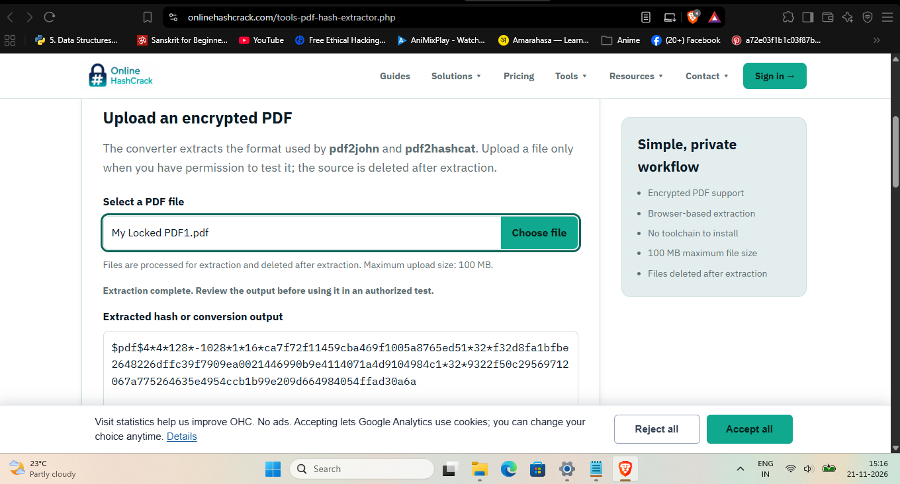
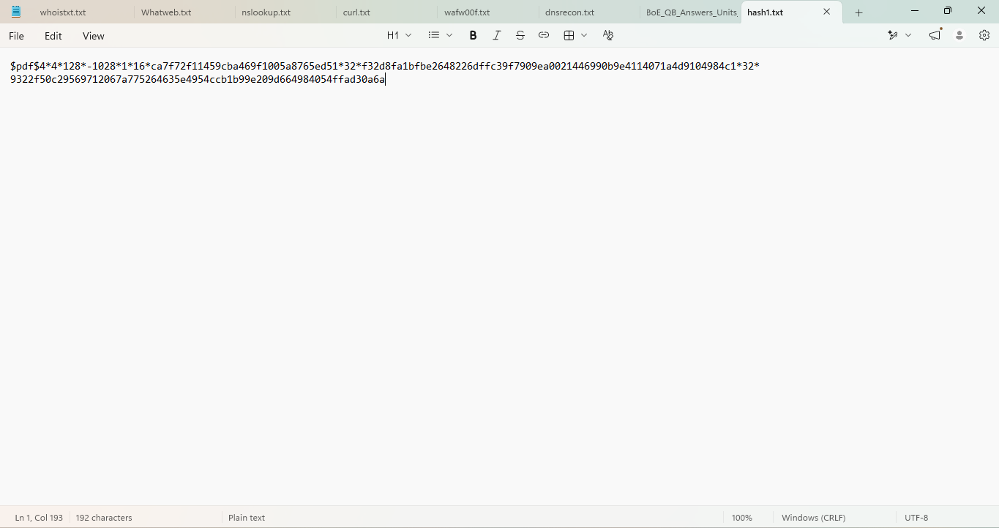
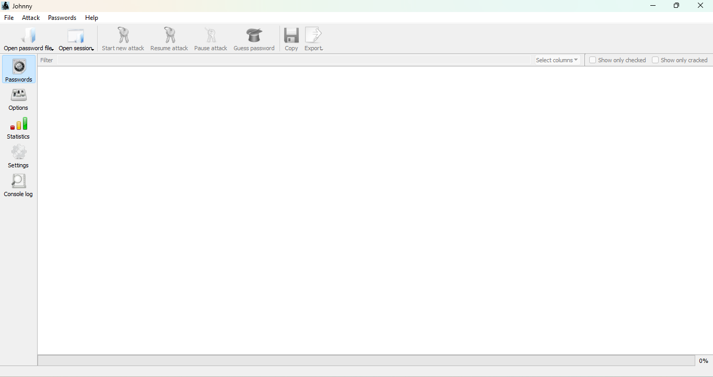
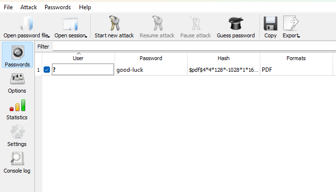
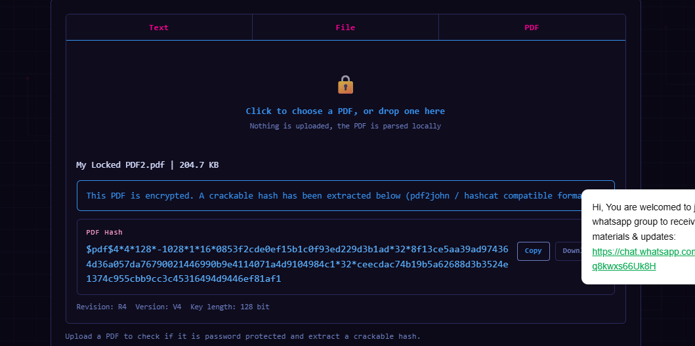
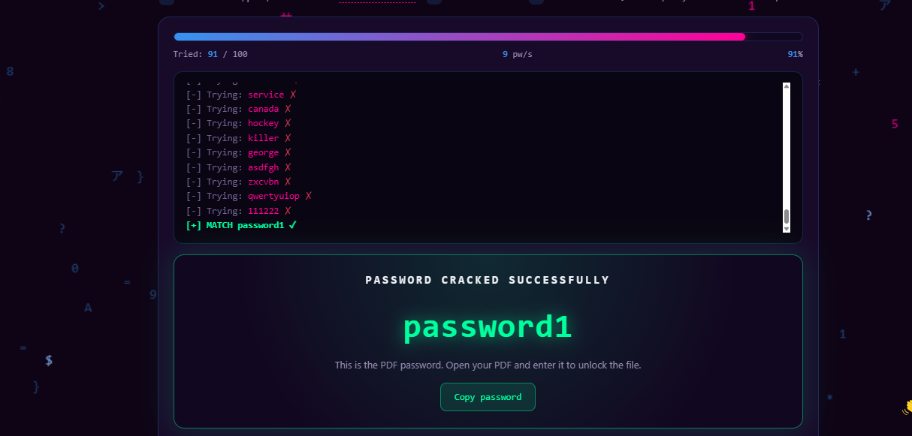
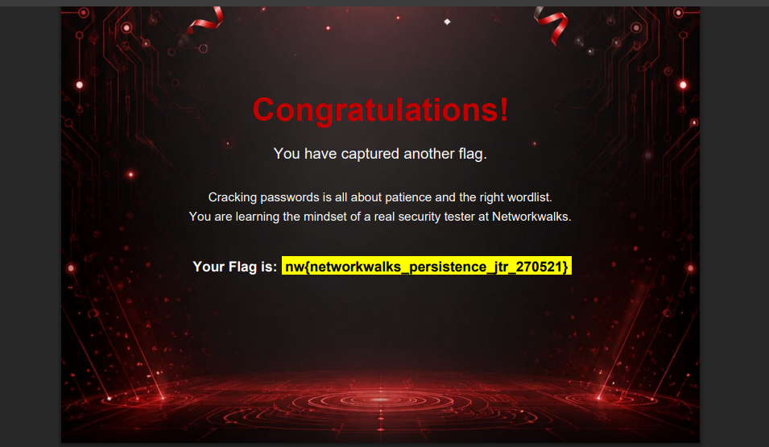

# Password Cracking Lab — Week 3 Project (Networkwalks)

Cybersecurity & Ethical Hacking training project: recovering the password of an encrypted PDF (`My Locked PDF1.pdf`) using two different approaches, as assigned in **Week 3 — Project Module 1 & 2**.

## Overview

| Module | Tool(s) Used | Method |
|---|---|---|
| Module 1 | John the Ripper (JTR) + Johnny GUI | Local dictionary attack on Windows |
| Module 2 | Networkwalks Hash Calculator + Password Cracker | Browser-based dictionary attack |

Both modules target the same locked file and both recover the same password.

## Background

Password-protected files (PDF, ZIP, Office docs) store their password as a **hash**, not as plain text. Hashing is a one-way function — it cannot be reversed directly. To recover a password, the hash is extracted from the file and then run through a cracking tool that hashes candidate words from a wordlist/dictionary and compares them against the target hash until a match is found.

- **Encryption** — two-way, reversible with the correct key.
- **Hashing** — one-way, used to validate rather than conceal-and-reverse data.

## Extracted PDF Hash

```
$pdf$4*4*128*-1028*1*16*ca7f72f11459cba469f1005a8765ed51*32*f32d8fa1bfbe2648226dffc39f7909ea0021446990b9e4114071a4d9104984c1*32*9322f50c29569712067a775264635e4954ccb1b99e209d664984054ffad30a6a
```

Saved locally as [`hash1.txt`](./hash1.txt).

## Module 1 — Cracking with JTR (John the Ripper + Johnny GUI)

**Steps performed:**

1. Downloaded John the Ripper (jumbo build) and the Johnny GUI for Windows.
2. Installed Johnny and, under **Settings**, pointed it to `john.exe` inside the JTR `run` folder.
3. Uploaded `My Locked PDF1.pdf` to an online PDF-hash extractor to convert the file into a crackable `$pdf$...` hash (pdf2john format).
4. Pasted the extracted hash into Notepad and saved it as `hash1.txt`.
5. In Johnny, used **Open password file** to load `hash1.txt`.
6. Clicked **Start new attack** and let JTR run its dictionary/incremental attack.
7. JTR cracked the hash and returned the password: **`password1`**.
8. Opened the PDF and entered `password1` to unlock it — flag captured.

## Module 2 — Cracking with Networkwalks Online Tools

**Steps performed:**

1. Opened the **Networkwalks Hash Calculator** (`networkwalks.com/hash-calculator`) and uploaded the locked PDF under the **PDF** tab.
2. The tool parsed the file locally in-browser and extracted the same `$pdf$...` hash.
3. Copied the full hash value.
4. Opened the **Networkwalks Password Cracker** (`networkwalks.com/password-cracker`) — a dictionary-attack lab tool (built-in 100-word list, same concept as John the Ripper).
5. Pasted the hash and clicked **Start Cracking**.
6. The tool tried candidate passwords one by one and reported a match: **`password1`**.
7. Opened the PDF and entered `password1` to unlock it successfully.

## Result

Both the local JTR/Johnny method and the Networkwalks online tools independently recovered the same PDF password:

```
password1
```

This confirms the password was weak (a common dictionary word + number), which is exactly why short/common passwords are cracked quickly and why strong, unique passwords matter.

## Key Takeaway

Password cracking is largely a function of **wordlist quality + patience**. A weak, predictable password like `password1` falls almost immediately to a basic dictionary attack, whether run locally via John the Ripper or through a lightweight browser-based tool.

---

## Screenshots (Evidence)

**1. Johnny GUI — initial empty state**


**2. Online PDF Hash Extractor — uploading locked PDF**


**3. Extracted hash saved in `hash1.txt`**


**4. Johnny GUI — hash loaded, password queued**


**5. Flag / congratulations page (Module 1)**


**6. Networkwalks Hash Calculator — PDF hash extracted**


**7. Networkwalks Password Cracker — password cracked successfully**


**8. Flag captured (Module 2) — `nw{networkwalks_persistence_jtr_270521}`**


---

*Lab materials: Networkwalks Training Academy — Cybersecurity & Ethical Hacking course, Week 3 Project Modules 1 & 2.*
